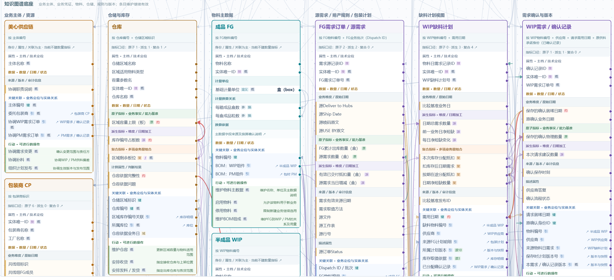
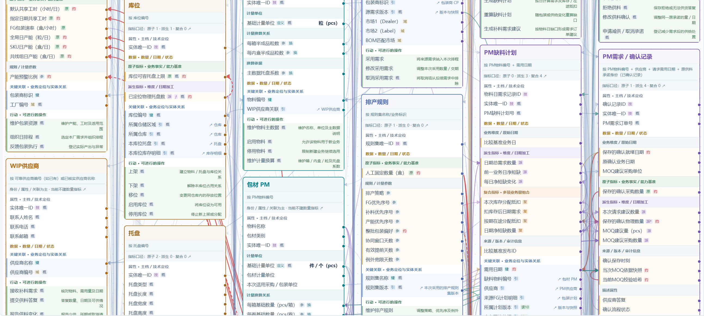
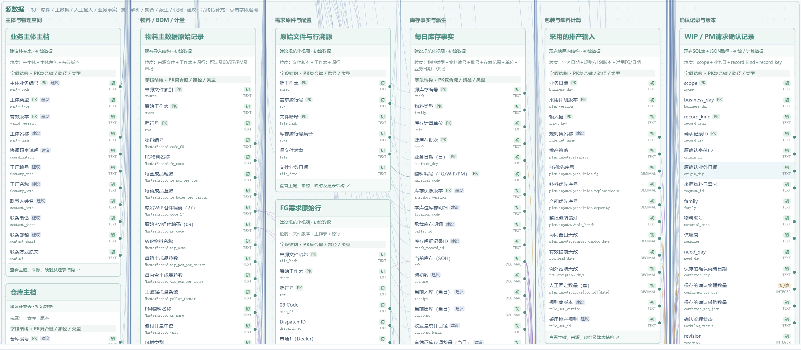
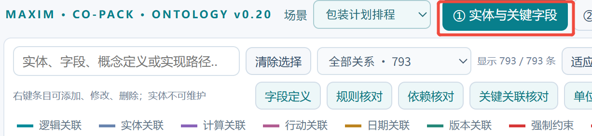

# APS Ontology v2：完整实体及实际源字段

- Issue：[ #149 ](https://github.com/huiliangtao666/APS/issues/149)；Closed / completed。
- event_key：`APS-USER-20261104-ONTOLOGY-ENTITY-FIELD-V2`
- 范围：用户要求重新制作独立HTML；不修改应用引擎、生产业务数据或发布状态。
- 参考：用户上传 Co-pack HTML 的“①实体与关联字段”及以下5张截图；理解其完整实体卡、条目级连线和数据源组织，APS字段按当前本地代码核对。
- 核对代码：`e0cd85084c7e3ff016656fa0c945f60b4288cd8d`。

## 用户要求与处理

| 要求 | 处理 |
| --- | --- |
| 实体包括业务对象、物料、业务凭证 | 48类实体，覆盖客户/供应商/工厂/仓库/设备/班组/工装/工艺/计划员、统一物料及分类、需求/任务/补单等 |
| 实体展开属性、数据、状态、行动、关系 | 594项完整条目、70项行动；注明操作者、前提、输入、影响、状态迁移及实现分级 |
| 数据区分原子、派生、负荷 | 独立指标目录；日期、参数、状态和参与区间不伪装为数量；粒度、量纲和不可加总规则明确 |
| 关系区分流程、计算、日期、行动、约束等 | 789条字段/行动端点关系；其中195条语义/行动关系、594条字段来源关系；含实体、版本和类型继承 |
| 数据源落到实际表结构字段 | 22张输入表337字段全部绑定；所有39张工作表按Schema保留实际字段名、类型与可空性，另列运行JSON、查询派生及概念结构 |
| 结合实际APS并允许概念完善 | 实际映射、结构投影、概念补充分级；不存在的正式生产计划、补料申请、实际收发流水不冒充现成功能 |

源码核对发现：分钟排程已支持重量共享及固定准备＋固定/按量加工；准备独立按量的完整两阶段配置仍属扩展。模拟补单草稿已有，正式业务补料单与供应确认闭环为概念。

实际源字段例：`snapshot.tables["期初库存"][i]["当前数量"]`；分配为`run.result.allocations[i]`且没有独立持久化id；E3/E4是API派生投影，不是SQL物理表。输入工作表全字段绑定不代表真实数据已完整或验收通过；参考结果页不作为本次排程权威结果。

## 交付

- 文件：`APS_生产排程_Ontology_实体与实际字段_v2.html`（工作区根目录；保留v1原件）。
- 大小：790527 bytes。
- SHA256：`df4f31d199919a7b2ac6d58b1241f1d913daa9691e4704f8d52d096771507980`。
- 功能：完整实体画布、字段级连线、浮动详情、表字段双向追溯、指标目录、关系目录、映射核对、缩放/筛选、保存HTML及导出JSON。
- 原始参考HTML和完整交付HTML不上传公开仓库，保留在用户工作区。

## 验证与限制

[验证记录](validation.json)：11项结构、字段、关系端点、独立HTML与浏览器导出检查通过。浏览器核对实体画布、指标分类、行动关系、源字段搜索、双向跳转、保存和导出；未发现error级控制台记录。

这是本体示例的任务级检查，不是生产排程UAT、业务实绩或新增引擎功能实现证据。

[实体底座效果](assets/entity-foundation.jpg) · [实际字段及反向映射](assets/actual-field-trace.jpg) · [逐表结构](assets/source-structures.jpg)

## 用户原始截图

五张原图均原样保留，未将截图内容当真实验收结论。

### 图1

### 图2

### 图3

### 图4

### 图5

## 清理

交付前核对du/df与lsof，清理5个可重建的解析副本及已校验的浏览器导出副本，释放6530277个逻辑bytes。原始上传、最终HTML、编制脚本/模型、验证证据和当前浏览器预览保留。没有清理其他任务目录、应用state、容器或平台服务；不据此推定内存或磁盘块已经恢复。逐项路径见验证记录`cleanup`字段。
